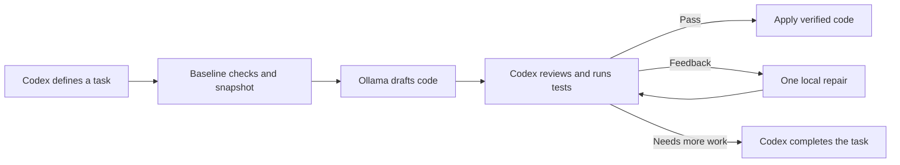

# ForgeRelay

**Cloud judgment. Local drafting. Verified code.**

**A practical hybrid coding workflow, built by Tarun Kishore.**

ForgeRelay connects Codex with local Ollama models to delegate small Python coding tasks. Codex plans the work, defines clear requirements and reviews the results. Ollama drafts the code, and independent tests verify it before application. The reusable Codex skill and runner need only Python's standard library.

## What you get

- **Focused delegation:** selected source, explicit constraints and acceptance criteria.
- **Reviewable proposals:** one Python file per task, ready for primary-agent inspection.
- **Independent verification:** baseline checks, frozen source and tests in a separate candidate directory.
- **Bounded feedback:** one precise worker repair attempt, with primary-agent fallback when needed.
- **Controlled application:** verified code, source-drift checks and backups for overwritten targets.
- **Traceable outcomes:** preserved attempts, test logs, local timing and usage records.

Start with small helpers, targeted unit tests and localized changes with clear expected behavior.



## Use it now

Requirements: Python 3.10+, a running Ollama service and an installed model. The Codex skill also needs a Codex environment with local shell access. Defaults: `qwen2.5-coder:7b`, 8192-token context, 1200-token output and one worker repair. Configure these in [config.json](skills/local-ollama-delegate/assets/config.json).

From this directory, after starting Ollama and installing the model:

```powershell
python delegate.py doctor --smoke
python -m unittest discover -s tests -v
python delegate.py report --project example-project
python economics.py estimate --scenario examples/conditional-savings.json
```

The included Python/SQLite booking backend demonstrates a locally generated money-formatting helper. After one feedback round, the helper passed all eight example-project tests without a manual code change. Run them with `python -m unittest discover -s tests -v` from `example-project`.

## Install the skill in another project

```powershell
python D:/Projects/ForgeRelay/install.py --project D:/Projects/my-project
```

Use an existing project directory. This installs the self-contained skill under that project's .agents/skills/local-ollama-delegate.  In a Codex session opened in the selected project, invoke:

```text
$local-ollama-delegate Help implement this feature. Delegate only a small helper or a few tests, and verify before applying.
```

Codex discovers project skills; restart if changes do not appear. The installer does not alter other skill names or global configuration. Existing copies require --update, after inspection. This is a skills-only local plugin package; a remote server, account upload or MCP connector is unnecessary for this shell-based workflow. This repository publishes the source; it is not a marketplace submission.

## Prepare a task

Use examples/money-helper.json as a complete working contract. Change the target and requirements to match your feature. Read [task-contract.md](skills/local-ollama-delegate/references/task-contract.md).

```powershell
python delegate.py run my-task.json --project D:/Projects/my-project
```

The result contains a run folder. Read its proposal.py. After master code review:

```powershell
python delegate.py verify RUN_FOLDER --reviewed
python delegate.py finish RUN_FOLDER --outcome accepted --reason "Independent tests and review passed"
python delegate.py apply RUN_FOLDER --reviewed
```

Replace RUN_FOLDER with the exact returned path. --reviewed denotes the primary agent's code inspection, not a requirement to ask you again for routine authorized edits. If the tests fail, provide concrete feedback:

```powershell
python delegate.py repair RUN_FOLDER --feedback errors.txt
```

Review/verify the new run. One repair is allowed. For a trivial master correction, edit the candidate file, reverify, and finish accepted_with_changes. If larger redesign is needed, record rejected and let the primary agent implement it. Never apply unchecked worker output.

## Reproduce the demo on a fresh baseline

```powershell
python examples/bootstrap_demo.py --directory D:/Projects/ollama-fresh-demo
python delegate.py run examples/money-helper.json --project D:/Projects/ollama-fresh-demo
```

The bootstrap refuses to overwrite an existing directory. Independent money tests exist in the new demo, but the helper is absent. Follow the review/verify procedure. If bool validation fails, examples/money-feedback.txt contains the exact feedback used in the successful live repair.

## Usage accounting

`report` returns actual local tokens/time, outcomes and entered review/primary-usage values. Missing primary usage is reported with zero entries and null net savings. It does not read Codex's subscription dashboard. `finish --primary-usage-units N` records an observation in your chosen consistent unit; include preparation, review, repair and fallback in the comparison.

The calculator separates unchanged subscription fees, conditional allowance savings, entered extra-spend changes, local electricity estimates and elapsed time. Edit examples/measurement-template.json with real matched primary-only and hybrid measurements, then:

```powershell
python economics.py compare --measurement my-measurement.json
```

The template intentionally cannot produce a result until you enter measurements and confirm matching acceptance/usage conditions. The 10% result in conditional-savings.json is an illustration, not a prediction for your subscription.

## Scope and safeguards

It checks baseline tests before dispatch, keeps source snapshots and artifacts within the selected project, validates syntax/output limits, executes only master-specified command arrays, requires explicit review before verification/application, backs up an overwritten target, refuses changed source or unverified candidate edits, and applies only one target file. It distinguishes accepted raw code from master-corrected code.

ForgeRelay currently proposes one Python file per task. Directory snapshots include Python source; list non-Python fixtures explicitly. The worker receives supplied context and generates text, while the primary agent owns review, test commands and application. The separate candidate directory is not a security sandbox: review generated code before execution. Available hardware, model quality and task scope influence outcomes. Net usage savings require comparable primary-only and hybrid measurements.

Relevant official documentation: [Codex skills](https://learn.chatgpt.com/docs/build-skills), [subscription pricing and usage](https://learn.chatgpt.com/docs/pricing), [Ollama parameters](https://docs.ollama.com/modelfile).

## Experiment and further reading

ForgeRelay grew from coding exercises and realistic booking-backend assignments. Those trials shaped its focus on small contracts, independent verification and bounded repairs. Read [the full experiment](WRITEUP.md) for methodology, benchmark outcomes and usage analysis, or [EVIDENCE.json](EVIDENCE.json) for summarized measurements.

Explore related projects: [Local Coding Agent](https://github.com/pvnc228/local-coding-agent), [delegate-local](https://github.com/IsmaelMartinez/delegate-local), and [rjv Codex/Ollama skills](https://github.com/rjvim/ai-skills).

Licensed under MIT.
