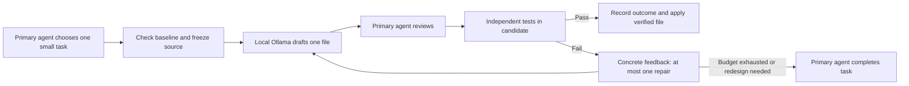

# ForgeRelay: testing Codex + local Ollama delegation

## Answer for this setup

The local model can assist with a small, precisely specified helper, but our full-feature trials did not demonstrate savings. Each failed assignment left implementation work with the primary agent and added briefing, inspection and validation. Expanding context to 32768 did not make any complete feature assignment acceptable.

The user pays through a ChatGPT/Codex subscription. Using the same plan means no reduction in its fixed fee. Possible benefits are preserving included allowance, avoiding extra credit purchases or completing more work within the allowance. Those benefits require measurement; API token prices are not a proxy for this subscription's consumption. [Official OpenAI pricing and usage guidance](https://learn.chatgpt.com/docs/pricing).

We did not collect a matched primary-only build's usage or the hybrid build's subscription consumption. We therefore cannot honestly report a percentage or money amount saved. Local inference avoided a cloud-model call for the worker generation itself; the primary agent's preparation, review, corrections and later conversation still consume primary usage.

## The experiment

The master agent used a local Ollama endpoint and qwen2.5-coder:7b, a 7.6-billion-parameter Q4_K_M model. It sent concrete coding tasks with source, contracts and rubrics, inspected outputs, and ran independent checks. The worker did not have tools or access to the master’s acceptance tests.

We first used five self-contained Python exercises: normalization, binary-search repair, interval merging, an LRU cache and dependency scheduling. The two easiest implementations passed the functional checks. Harder tasks missed requirements such as input preservation, boolean-capacity rejection and dependency direction. These introductory scores were 95, 95, 77.5, 88.1 and 37.5; scores included explanation/tests and are not economic measurements.

We then built SeatFlow, a realistic workshop booking backend. Its baseline separated domain models/errors, money rules, catalog validation, SQLite schema, queries, transaction ownership, reservations, inventory and audit records. Its reviewed final version has thirteen production modules and explicit tests for concurrency, idempotency, cutoff dates, reporting and FIFO waitlist promotion. This is a backend prototype, not a production application with authentication/payments/deployment.

The five full assignments were:

1. Add pricing regression tests with discount, tax and rounding coverage.
2. Implement owner cancellation with a 24-hour notice boundary and safe retries.
3. Build live inventory/revenue reporting with cursor pagination and one SQL query.
4. Implement persisted idempotency keys for checkout retries and concurrent requests.
5. Build waitlist join/withdrawal and atomic cancellation/promotion with FIFO fairness.

Each used an independent baseline copy so one failure did not contaminate subsequent tasks. Prompts included exact signatures, allowed paths, error behavior, existing schema, UTC-clock semantics, money units, transaction rules, test requirements and a 100-point rubric. Source and raw answers were saved before review; incomplete answers were not silently reconstructed. This was single-pass generation, followed by two separately labeled focused jobs, rather than a tool-using local agent repeatedly running its own tests.

## Results and the larger-context comparison

| Assignment | Context 16384 | Context 32768 |
|---|---|---|
| Existing pricing tests | Failed assertions/imports | Identical failed answer |
| Cancellation | Invalid Python and rule errors | Invalid Python and rule errors |
| Inventory report | Truncated output | Complete output, incorrect code/query |
| Idempotency | Truncated, repetitive output | Truncated, repetitive output |
| Atomic FIFO waitlist | Invalid code | Truncated, repetitive output |

No full assignment passed without corrections in either run. The master completed most feature integration. A focused promotion helper was useful after one repository-import correction; its loop was retained and verified. A focused pricing-test draft required substantial assertion/import fixes.

For the rerun, baseline source, tests, prompts and other settings were identical. The full assignments used temperature 0, seed 42 and an 8192-token output cap. Runtime snapshots confirmed the requested 32768 context. The two focused assignments originally used 8192 context and were also repeated at 32768 with their original 3500-token output cap.

Full-assignment local time was 366.57 seconds at 16384 and 454.79 seconds at 32768. Different answer lengths affect that total. Generation throughput fell from roughly 57–62 to 44–47 tokens/second, while runtime placement changed from fully on GPU to 92% GPU / 8% CPU. Reporting completed more cleanly, but no complete task became correct. One seeded run per configuration is insufficient to establish a statistical model ranking or a universal context effect.

Prompts contained only 2740–2997 tokens. Adding the maximum 8192-token output still fits within 16384, so lack of room for the supplied task was not demonstrated. Context allocation and generated-output limit are different parameters. Larger context increases memory needs and may cause offloading. [Ollama parameters](https://docs.ollama.com/modelfile), [context-length guidance](https://docs.ollama.com/context-length).

The reviewed SeatFlow integration passed 32 discovered tests and 20 additional acceptance methods. Its pricing tests detected deliberate stacked-discount, gross-tax and changed-rounding regressions. Those results verify the integrated master-reviewed build; they are not evidence of an unmodified worker producing the whole feature.

## A reusable, bounded workflow

This kit packages the workflow as a project Codex skill and dependency-free Python runner. The local model remains a worker, and the primary agent owns planning, contracts, review and final correctness.



The runner uses 8192 context and a 1200-token response cap by default. It passes only selected source, puts the final contract after that source, retains all artifacts and returns compact status information. It proposes one Python output file rather than multiple methods and sprawling test scaffolding. It neither prints a long transcript into the primary agent's context nor applies code automatically.

Baseline checks must pass before dispatch. The master reviews code before running it in an isolated candidate; that directory is not a security sandbox. Tests come from the master’s contract, and independent evaluator tests can be included in the snapshot without being sent to the worker. Each run is identified by a new UUID, so repairs preserve earlier evidence. Acceptance records distinguish raw accepted code from master-corrected code, and application refuses changed source or a candidate edited since validation.

During live verification of this kit, the worker wrote a money-formatting helper in 1.953 seconds but accepted bool as int despite the exact contract. Independent tests caught True/False. The master supplied precise feedback, and the local worker fixed its type check in 1.687 seconds. Four baseline and four independent feature tests then passed; the reviewed helper was applied to the example project. Total local generation time was 3.64 seconds, with 1148 local prompt tokens and 195 generated tokens over both attempts. No primary-usage saving was measured. This supports bounded feedback as an operational improvement for this example, not a general success-rate estimate.

The kit has fifteen automated tests covering source containment, failed baselines, stale-source protection, unverified edits, truthful correction records, bounded repair, preserved snapshots and the calculator. It was also tested against the real local Ollama endpoint and validated as a Codex skill. install.py makes the skill reusable in a selected project. It needs no cloud API key, MCP server or account upload.

## When could it save usage?

For an eligible task, let D be the usage needed for direct primary implementation, O the primary overhead for delegation/review/correction, and p the chance the local result replaces direct implementation. If a failed result still needs the original implementation, expected hybrid primary usage is:

```text
hybrid usage = O + (1 - p) × D
usage saved = p × D - O
```

The workflow is beneficial only when avoided primary work exceeds the added overhead. Review is necessary work; replacing implementation with review can still save usage when the draft is mostly correct. When the draft fails and the primary agent rewrites it, the workflow becomes direct implementation plus overhead. That is additional work, though it need not literally double every task.

If eligible work accounts for fraction f of a project and overhead is h=O/D, conditional project savings are f(p-h).

| Hypothetical case | Eligible share f | Replacement success p | Overhead ratio h | Project usage change |
|---|---:|---:|---:|---:|
| Useful bounded helpers | 20% | 80% | 30% | 10% less |
| Expensive review/weak drafts | 20% | 40% | 50% | 2% more |
| All eligible assignments fail | 20% | 0% | 30% | 6% more |

These are illustrations, not measured predictions for the user's allowance. The failed full-feature trials do not justify the optimistic success rate. In the live helper example, the master could have written the short function directly; without comparing primary usage, quick local generation alone does not prove a saving.

Local inference also uses electricity and hardware. As an illustration, 100 W for ten minutes at INR 8/kWh is about INR 0.13 of electricity. We did not measure this machine's whole-system wattage or tariff; hardware amortization and human time are omitted. The calculator labels such estimates and reports unchanged fixed subscription fees separately.

## How to measure a real benefit

Use matched tasks and the same acceptance criteria. Start equivalent primary contexts, hold model/speed mode constant, and record subscription usage through the dashboard in comparable reset windows. Include task briefing, code review, repairs, fallback and final verification. Record wall time separately from active primary work. Both builds must pass before comparing their usage.

Collect several matched tasks across the task types actually delegated. Where possible, use fresh variants or counterbalance the order to reduce the advantage of having already solved a task. Dashboard percentage readings may be too coarse for one tiny helper; aggregate enough matched work and record the units/window conditions. Do not convert local tokens to primary savings or substitute API dollar rates for subscription allowance.

The reusable report records actual local metrics and optional manually entered primary usage. Its net-savings field remains null until a counterfactual baseline exists. The calculator compares entered matched totals and keeps allowance savings, unchanged subscription fees, additional purchases, estimated local energy and elapsed time separate.

For this model, retain broad feature design and transactional integration with the primary agent. Try small helpers or a few tests with exact contracts and one feedback attempt. Continue only for task types whose accepted outcomes and measured usage actually improve the build process.
